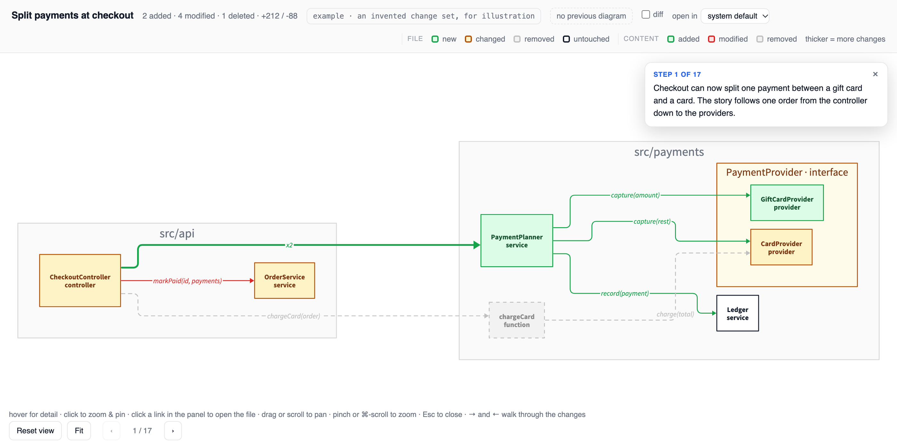

# superreview

A Claude Code skill that draws code changes as an interactive diagram in a self-contained HTML page.

Boxes are files and classes, arrows are calls between them, and colour marks what was added, changed or
removed. Hovering explains what changed and why; clicking pins the details, where each line number opens
that line in your editor. It diagrams your uncommitted work by default, or a commit range, a branch, a
pull request, a whole repo, or the files a plan document proposes to touch.

Ask for it in plain words: "diagram my changes", "show me what this PR touches".

[](https://robertocaldas.github.io/superreview/)

**[Try the example](https://robertocaldas.github.io/superreview/)**: an invented change set you can hover, click and zoom.
Pages are written to `docs/superreview/` in the repo, each linking back to the previous one.

## Why not UML?

UML describes how a whole system is built, with many kinds of diagram and many rules. I wanted to try
something simpler, made for one job: to make code reviews easier. Each box is a file and each arrow is a call. Colour shows
what changed, and the AI writes a short note on every box and arrow that says what changed and why.

## Requirements

- [d2](https://d2lang.com) on `PATH` — `brew install d2`, or `winget install terrastruct.d2`
- `python3`

## Install

At the prompt of a terminal session:

```
/plugin install superreview --marketplace robertocaldas/claude-plugins
```

Answer `y` to add the marketplace, then pick a scope.

From a shell:

```
claude plugin install superreview --marketplace robertocaldas/claude-plugins
```

## Using the page

| Action | Effect |
|---|---|
| Hover | Details of a file or call |
| Click | Pin the details; links open the file at that line |
| Drag or scroll | Pan |
| Pinch or ⌘-scroll | Zoom; once you zoom, only Reset view and Fit change it again |
| Esc | Close the details |

The **diff** checkbox shows each change's hunk in the pinned panel, and **open in** picks your editor.
